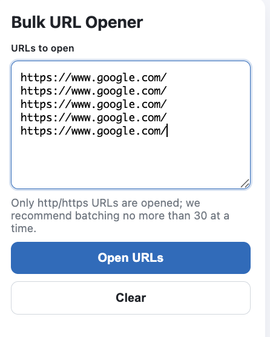

  

# Bulk URL Opener

[日本語](README.md)

Bulk URL Opener is a Chrome extension that opens a list of pasted URLs in new tabs at once.

Paste URLs separated by line breaks or commas, press one button, and each one opens in a background tab, one after another. Use it when you need to check many pages without spreadsheets or scripts.

## Features

- **Line breaks or commas.** Blank lines and entries that are not URLs are skipped.
- **Only http and https.** `javascript:` and other schemes are never opened. URLs without a scheme get `https://`.
- **See the count first.** The number of URLs that will actually open is shown next to the input.
- **One tab at a time.** Tabs are created sequentially to avoid a sudden burst. A batch of 30 is shown as a guideline, not a limit.
- **Nothing leaves your browser.** The only permission is `tabs`; there is no analytics and no network access.
- **English and Japanese.** The popup follows the browser language.

## Example

  

## Requirements

| What | Used for |
| --- | --- |
| Google Chrome (a Manifest V3 version) | Running the extension |

## Installation

Load it from source.

1. Clone this repository, or download and extract the ZIP.
2. Turn on **Developer mode** in `chrome://extensions`.
3. Click **Load unpacked** and select the folder.

## Usage

1. Click the extension icon in the toolbar.
2. Paste URLs separated by line breaks or commas.
3. Press **Open URLs**. Each URL opens in a new background tab.

| When | Do this |
| --- | --- |
| You have many URLs to open | Open them in batches of about 30, which helps avoid rate limits on the destination sites |
| A pasted URL is not counted | Check that it is an http / https URL with a domain or an IP address |

## Limitations

- Duplicate URLs are not merged; each copy opens its own tab.
- Names without a domain, such as `localhost`, are not treated as URLs.
- Pages that fail to load because of the destination site's limits are not detected.
- There is no scheduling or recurring opening.

## Development

There is no build step. After editing, reload the extension in `chrome://extensions`.

Background and UX decisions are in [docs/design.md](docs/design.md), and manual test steps in [docs/TESTING.md](docs/TESTING.md) (both Japanese).

## License

[MIT](LICENSE)
