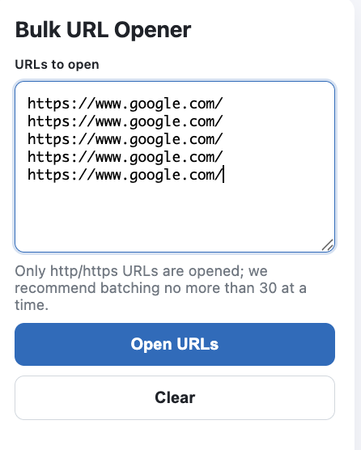

  

# Bulk URL Opener

[English](README.en.md)

Bulk URL Opener は、貼り付けた複数の URL を、まとめて新しいタブで開く Chrome 拡張です。

改行かカンマで区切った URL を、ボタン 1 つでバックグラウンドのタブへ順に開きます。表計算やスクリプトを使わずに、多くのページを一度に確かめたいときに使います。

## 特徴

- **改行とカンマの両方で区切れる。** 空行と URL でない行は飛ばします。
- **http と https だけを開く。** `javascript:` などのスキームは開きません。スキームを省いた URL には `https://` を付けます。
- **開く件数が先に分かる。** 入力欄の横に、実際に開く URL の件数を表示します。
- **1 件ずつ順に開く。** ブラウザに一度に負荷をかけないよう、タブを 1 件ずつ作ります。一度に開くのは 30 件までを目安として表示します（上限ではありません）。
- **外へ何も送らない。** 権限は `tabs` だけで、計測も通信もしません。
- **日本語と英語で表示する。** ブラウザの言語に合わせて切り替えます。

## 画面例

  

## 動作環境

| 必要なもの | 用途 |
| --- | --- |
| Google Chrome（Manifest V3 に対応した版） | 拡張の実行 |

## インストール

ソースから読み込みます。

1. このリポジトリを clone するか、ZIP で取得して展開します。
2. `chrome://extensions` で「デベロッパー モード」をオンにします。
3. 「パッケージ化されていない拡張機能を読み込む」で、取得したフォルダを選びます。

## 使い方

1. ツールバーの拡張機能のアイコンをクリックします。
2. URL を改行かカンマで区切って貼り付けます。
3. 「まとめて開く」を押すと、URL ごとに新しいタブがバックグラウンドで開きます。

| こんなとき | こうする |
| --- | --- |
| 大量の URL を開きたい | 30 件前後ずつに分けて開く。開く先のサイトの制限に掛かりにくくなる |
| 貼った URL が件数に数えられない | ドメインか IP アドレスを含む http / https の URL か確かめる |

## できないこと

- 同じ URL をまとめません。重複した URL は、その数だけタブを開きます。
- `localhost` のような、ドメインの無い名前は URL として扱いません。
- 開く先のサイトの制限で表示に失敗したページは、検知できません。
- 予約や定期的に開く機能はありません。

## 開発

ビルドの手順はありません。ファイルを直したら、`chrome://extensions` で拡張を再読み込みします。

背景と UX の判断は [設計](docs/design.md)、手動で確かめる手順は [テストガイド](docs/TESTING.md) にあります。

## ライセンス

[MIT](LICENSE)
